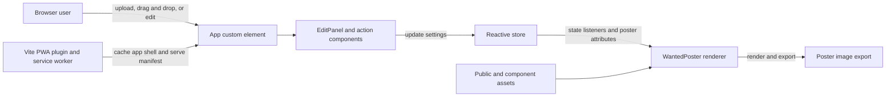

# Architecture

The application is organized as a set of custom web components backed by a small reactive state layer.

## High-level structure

- `src/main.ts` imports the app components and bootstraps the application
- `src/store.ts` defines the global poster state and listener system
- `src/components/App/index.ts` wires the main UI together and handles file imports/export actions
- `src/components/WantedPoster/` renders the poster layout and export logic
- `src/components/EditPanel/` provides the text and style controls
- `src/components/OptcGalleryPanel/` provides preset gallery entries
- `public/` stores static image assets used as poster backgrounds and app resources
- `vite.config.ts` configures Vite, PWA generation, and the app manifest

## Application flow

The main interaction path runs from browser input through the shared store into the poster renderer. Static assets and the generated PWA service worker support the same client-side application without requiring a backend.

## State model

The store is a centralized proxy-based state container. It exposes defaults for values such as:

- photo URL
- name and bounty text
- filter values
- font settings
- spacing values
- shadow settings

When the store changes, listeners update the poster UI and the relevant attribute values on the poster component.

## UI composition

The app is largely component-driven:

- `App` is the root container and orchestrates interactions
- `EditPanel` shows the user controls
- `WantedPoster` composes the visual poster structure
- `WantedButton` and `IconButton` provide the action controls
- `TipsDialog` and `OptcGalleryPanel` are optional helper panels

This design keeps responsibilities clean: the store manages state, the app connects actions to state changes, and the poster component focuses on rendering the final composition.

## PWA and browser integration

The project uses `vite-plugin-pwa` with an injectManifest strategy. This configures:

- a service worker
- web app manifest metadata
- an installable app shell
- file-handler support for local image import

This makes the project behave like an installable desktop/mobile web app while still being a static frontend.
